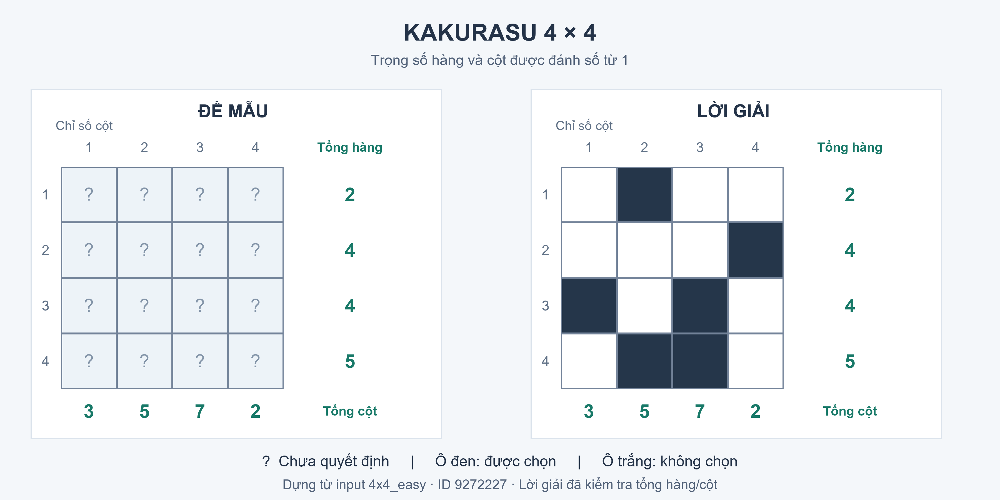

# Kakurasu

## 1. Luật chơi, đề mẫu và lời giải

Kakurasu gồm một bảng có n hàng và m cột. Người chơi chọn một số ô để tô đen.
Chỉ số hàng và cột được đánh số từ 1. Một ô đen ở hàng i, cột j đóng góp j điểm
vào tổng hàng i và i điểm vào tổng cột j. Ô trắng đóng góp 0. Mục tiêu là
làm cho tổng có trọng số của mọi hàng và mọi cột bằng đúng gợi ý tương ứng.
Không có yêu cầu các ô đen phải liên thông hoặc không được tiếp xúc nhau.



*Hình 1. Đề 4×4 có mã 9272227 và lời giải. Hình được dựng từ
`data/kakurasu_4x4_easy.json`; lời giải đã được kiểm tra bằng `verify()`.
Dấu ? biểu thị ô chưa quyết định.*

Đề mẫu có gợi ý hàng R = [2, 4, 4, 5] và gợi ý cột C = [3, 5, 7, 2].
Quy ước 1 là đen, 0 là trắng, lời giải là:

```text
0 1 0 0
0 0 0 1
1 0 1 0
0 1 1 0
```

Ví dụ, hàng 3 có hai ô đen ở cột 1 và 3 nên tổng bằng 1 + 3 = 4.
Cột 3 có ô đen ở hàng 3 và 4 nên tổng bằng 3 + 4 = 7. Kiểm tra toàn bộ lời giải
cho tổng hàng [2,4,4,5] và tổng cột [3,5,7,2], khớp với các gợi ý.

## 2. Mô hình hóa và định dạng input JSON

### 2.1. Trạng thái và trạng thái ban đầu

Trạng thái là tuple bất biến s = (x₁, …, xₖ), với mỗi x thuộc {0, 1} và
0 ≤ k ≤ n·m. Tuple lưu các ô đã quyết định theo từng hàng, từ trái sang phải.
Các ô sau tiền tố này chưa được quyết định; chúng được xuất thành `null` trong
view JSON. Trạng thái ban đầu là tuple rỗng `()`.

Ví dụ, `s = (0, 1, 0, 0)` trên bảng 4×4 nghĩa là hàng đầu đã được quyết định
trắng–đen–trắng–trắng, còn ba hàng sau chưa quyết định.

Mỗi tiền tố có đúng một đường đi từ gốc. Trước cắt tỉa, cây có độ sâu n·m,
tối đa 2^(n·m) lá và 2^(n·m + 1) − 1 node tính cả gốc và các tiền tố.

### 2.2. Hành động, chi phí và trạng thái đích

Với k = len(s), code xác định ô tiếp theo bằng `(r, c) = divmod(k, m)`.
Hai hành động là tô đen hoặc để trắng ô này, lần lượt tạo `s + (1,)` và
`s + (0,)`. Code dùng chỉ số từ 0, còn công thức trọng số dùng chỉ số từ 1.
`successors(s)` trả về `(action, next_state, cost)` và xét giá trị 1 trước 0.

Chi phí một bước là c(s, s′) = v, với v là giá trị vừa thêm. Do đó:

```text
g(s) = tổng các giá trị đã quyết định = số ô đen đã tô.
```

Trạng thái đích phải có đủ n·m ô và thỏa đồng thời:

```text
Với mọi hàng i:  Σ(j=1..m) j·x[i,j] = R[i].
Với mọi cột j:   Σ(i=1..n) i·x[i,j] = C[j].
```

Với cách tính này, bài toán tối ưu là tìm lời giải có ít ô đen nhất. Số hành động
luôn bằng n·m vì mỗi ô được quyết định đúng một lần. Hai đại lượng này cần được
phân biệt khi xét lời giải mà DFS, BFS và A* trả về.

### 2.3. Input JSON

```json
{
  "puzzle": "kakurasu",
  "name": "4x4_easy",
  "source": "https://www.puzzle-kakurasu.com/",
  "puzzle_id": "9272227",
  "rows": 4,
  "cols": 4,
  "row_clues": [2, 4, 4, 5],
  "col_clues": [3, 5, 7, 2]
}
```

`Kakurasu.from_file()` đọc `row_clues` và `col_clues`, sau đó suy ra n và m từ
độ dài hai danh sách. `puzzle_id` và `source` dùng để đối chiếu nguồn đề;
`rows` và `cols` mô tả kích thước. Hàm đọc hiện chưa kiểm tra hai trường kích
thước có khớp danh sách gợi ý hay không. Mức cắt tỉa được chọn qua tham số
`prune` khi tạo mô hình.

## 3. Cắt tỉa

Code hỗ trợ ba mức `none`, `basic`, `full`.

| Mức | Điều kiện loại nhánh | Cơ sở đúng đắn |
|---|---|---|
| `none` | Không cắt nhánh theo tổng; kiểm tra đích khi đủ ô. | Dùng làm đối chứng vét cạn trên đề nhỏ. |
| `basic` | Tổng hàng hoặc cột của ô vừa quyết định vượt gợi ý. | Các trọng số đều dương; quyết định các ô tiếp theo chỉ giữ nguyên hoặc tăng tổng, không thể sửa một tổng đã vượt. |
| `full` | Phần thiếu của hàng hoặc cột không thuộc tập các tổng tập con tạo được từ những trọng số còn chưa quyết định. | Bất kỳ lời giải tiếp nối nào cũng phải chọn một tập con trong đúng các ô còn lại; nếu không có tập con tạo được phần thiếu thì nhánh không thể có lời giải. |

Đối với hàng i, gọi Aᵢ là tập chỉ số cột chưa quyết định và ΔRᵢ là phần
còn thiếu của tổng hàng. Điều kiện cần để hoàn thành hàng là:

```text
ΔRᵢ ∈ {Σ(j∈U) j : U là tập con của Aᵢ}.
```

Điều kiện tương tự áp dụng cho cột với tập chỉ số hàng chưa quyết định.
Bảng `subset_tables()` tính trước tập tổng khả đạt và số phần tử ít nhất
bằng quy hoạch động. Mỗi trọng số chỉ được dùng tối đa một lần.

Ví dụ trên đề mẫu, nếu tô đen ô (1,1), hàng 1 mới có 1 điểm và còn thiếu 1.
Các ô còn lại của hàng có trọng số {2,3,4}; không tập con nào tạo được tổng 1.
`full` loại ngay nhánh này. `basic` vẫn giữ vì tổng hiện tại 1 chưa vượt 2.

`_ok()` kiểm tra hàng và cột của ô vừa quyết định. Các dòng khác không thay đổi
tổng hoặc tập ô còn lại ở bước đó, nên không cần kiểm tra lại nếu trạng thái cha
đã được sinh hợp lệ từ gốc. `full` chỉ kiểm tra điều kiện cần theo từng dòng;
một trạng thái vượt qua kiểm tra vẫn có thể không có lời giải toàn cục.

## 4. Áp dụng blind search: DFS và BFS

DFS và BFS dùng chung lớp `Kakurasu` qua ba hàm `initial_state()`,
`successors()` và `is_goal()`. Chúng thuộc nhóm tìm kiếm mù vì thứ tự duyệt
không dựa trên ước lượng khoảng cách hoặc chi phí đến đích. Các ràng buộc
trong `successors()` chỉ quyết định nhánh nào còn được xét.

### 4.1. DFS

DFS dùng stack để duyệt sâu theo các quyết định liên tiếp. Vì successor được
sinh theo thứ tự đen rồi trắng, solver đảo danh sách con trước khi đưa vào
stack để nhánh tô đen được lấy ra trước. Nếu nhánh không còn successor hoặc
đến bảng đủ ô nhưng sai tổng, solver tiếp tục lấy một nhánh khác từ stack.

Solver kiểm tra đích khi lấy trạng thái ra khỏi stack và dùng bảng `parent`
để dựng lại đường lời giải. Do bảng này giữ cả những trạng thái đã thăm,
bộ nhớ của hiện thực còn phụ thuộc số trạng thái đã lưu, ngoài đường đi hiện tại.

### 4.2. BFS

BFS dùng queue FIFO và duyệt theo số ô đã quyết định: tiền tố độ dài k
được xử lý trước tiền tố độ dài k + 1. Code kiểm tra đích ngay khi sinh node con
và dựng lại lời giải từ bảng `parent`.

Trong mô hình này, mọi đích đều ở độ sâu n·m. Vì vậy lời giải mà BFS tìm được
không có ít hành động hơn lời giải DFS. Chi phí cạnh lại là 0 hoặc 1, nên BFS
cũng không bảo đảm lời giải ít ô đen nhất. Về cách lưu trạng thái, BFS giữ các
tiền tố đang chờ xét theo tầng, còn DFS ưu tiên đi sâu theo thứ tự successor.

Ví dụ chạy hai thuật toán trên cùng đề:

```python
from core import Limits, dfs, bfs
from puzzles.kakurasu import Kakurasu, verify

for solve in (dfs, bfs):
    p = Kakurasu.from_file("data/kakurasu_4x4_easy.json", prune="full")
    result = solve(p, limits=Limits(time_limit=30, max_nodes=50000))
    if result.found:
        assert verify(p.to_grid(result.final_state), p.row_clues, p.col_clues)
```

## 5. Heuristic cho A*

### 5.1. Công thức

Đặt M(A, Δ) là số phần tử ít nhất của một tập con U ⊆ A có tổng bằng Δ.
Nếu không có tập con phù hợp, đặt M(A, Δ) = ∞. Trong đó A là tập trọng số
còn chưa quyết định; Δ là gợi ý trừ tổng hiện tại.

```text
h_row(s) = Σ(i=1..n) M(Aᵢ, ΔRᵢ).
h_col(s) = Σ(j=1..m) M(Bⱼ, ΔCⱼ).
h(s)     = max(h_row(s), h_col(s)).
f(s)     = g(s) + h(s).
```

Bⱼ là tập chỉ số hàng chưa quyết định trong cột j. Các giá trị M được lấy
từ bảng số phần tử ít nhất của `subset_tables()`. Heuristic ước lượng số ô
đen còn cần, cùng đơn vị với chi phí g. Code A* ưu tiên f nhỏ nhất; nếu hòa f
thì ưu tiên h nhỏ hơn, rồi thứ tự sinh node.

### 5.2. Ví dụ tính tay trên một trạng thái

Xét đề mẫu ở trạng thái `s = (0,1,0,0)`: hàng 1 đã hoàn tất, ba hàng còn lại
chưa quyết định. Vì chỉ có một ô đen đã tô nên g(s) = 1.

| Hàng | Phần thiếu | Trọng số còn được chọn | Số ô ít nhất và một cách đạt |
|---|---:|---|---|
| 1 | 0 | Không còn ô | 0 |
| 2 | 4 | {1,2,3,4} | 1: chọn 4 |
| 3 | 4 | {1,2,3,4} | 1: chọn 4 |
| 4 | 5 | {1,2,3,4} | 2: chọn 1 + 4 |

Suy ra h_row(s) = 0 + 1 + 1 + 2 = 4. Các cách chọn trong bảng là nghiệm của
từng hàng riêng lẻ, chưa bắt buộc đồng thời khớp các cột.

Tổng cột hiện tại là [0,1,0,0], nên phần thiếu của bốn cột là [3,4,7,2].
Mỗi cột còn các ô ở hàng {2,3,4}:

| Cột | Phần thiếu | Số ô ít nhất và một cách đạt |
|---|---:|---|
| 1 | 3 | 1: chọn hàng 3 |
| 2 | 4 | 1: chọn hàng 4 |
| 3 | 7 | 2: chọn hàng 3 và 4 |
| 4 | 2 | 1: chọn hàng 2 |

Do đó h_col(s) = 1 + 1 + 2 + 1 = 5, h(s) = max(4,5) = 5 và
f(s) = 1 + 5 = 6. Lời giải ở Hình 1 còn cần 5 ô đen sau trạng thái
này. Ở trạng thái đầu, h_row = 5, h_col = 6 nên h = 6; ở đích hợp lệ, h = 0.

### 5.3. Chứng minh admissible

Gọi h*(s) là số ô đen bổ sung ít nhất của một lời giải hoàn chỉnh tiếp nối s.
Với bất kỳ lời giải tiếp nối nào, số ô đen bổ sung trên hàng i không thể nhỏ hơn
M(Aᵢ, ΔRᵢ). Vì mỗi ô đen thuộc đúng một hàng, cộng theo hàng cho h_row(s) ≤ h*(s).
Lập luận theo cột tương tự cho h_col(s) ≤ h*(s). Vì vậy:

```text
h(s) = max(h_row(s), h_col(s)) ≤ h*(s).
```

Như vậy, h không đánh giá quá cao chi phí tối ưu còn lại, thỏa tính admissible.
Phép cộng h_row + h_col có thể đếm cùng ô đen hai lần vì ô đó đóng góp cho cả
hàng và cột. Lấy giá trị lớn hơn của hai cận tránh được việc này. Nếu một dòng
không thể hoàn thành thì trạng thái không có lời giải, ứng với h = h* = ∞.

Heuristic còn nhất quán: với quyết định giá trị v, một phương án hoàn thành
trạng thái con kết hợp với ô vừa quyết định là phương án cho bài toán nới lỏng
của trạng thái cha. Do đó h_row(s) ≤ v + h_row(s′), tương tự cho cột; lấy max
cho h(s) ≤ c(s,s′) + h(s′). Tại đích hợp lệ, h = 0.

Cây trạng thái hữu hạn, chi phí cạnh không âm và cắt tỉa giữ các đường dẫn đến
lời giải. Với heuristic trên, A* trả lời giải tối ưu theo số ô đen khi chạy đến
đích. Nếu dừng vì giới hạn node hoặc thời gian, kết quả chỉ cho biết solver
chưa tìm được lời giải trong ngân sách đã đặt.

Trong hiện thực hiện tại, node có h = ∞ vẫn được đưa vào heap và nằm sau các
node có f hữu hạn. Chúng vẫn có thể được mở rộng khi các node hữu hạn đã hết,
chẳng hạn trên một đề vô nghiệm.

## 6. Kiểm thử và kết quả chạy

File [test_kakurasu.py](../tests/test_kakurasu.py) có 18 test. Các trường hợp
kiểm tra gồm dữ liệu đầu vào, mô hình, cắt tỉa, heuristic, solver và trace.

| Phần kiểm tra | Các trường hợp đã xét |
|---|---|
| Dữ liệu và bảng tổng tập con | Đủ 12 input; tập tổng khả đạt và số ô ít nhất khớp với ví dụ tính tay. |
| Hàm `verify()` | Nhận lời giải đúng; loại lưới sai tổng, sai kích thước, hàng không đều và ô không phải số nguyên 0/1. |
| Sinh trạng thái và xuất view | Đúng thứ tự successor và định dạng action/state/cost; phân biệt ô trắng với ô chưa quyết định. |
| Cắt tỉa | `full` loại nhánh bất khả thi sớm hơn `basic`; cả hai giữ đường dẫn tới lời giải mẫu. |
| Heuristic | Kiểm tra giá trị trên đường lời giải và trạng thái chết; dùng oracle vét cạn trên lưới 2×2, 2×3 để đối chiếu cận dưới, tính nhất quán và việc giữ nghiệm. |
| Tính duy nhất của đề mẫu | Vét cạn 2^16 bảng 4×4 và chỉ tìm được lời giải ở Hình 1. |
| Ghép solver | DFS, BFS và A* giải cả 12 đề với `full`; A* giải cả 12 đề với `basic`. |
| Trace | So sánh hai trace lưu sẵn với trace sinh lại; kiểm tra trạng thái đích và trường hợp A* mở node h = ∞ trên đề vô nghiệm. |

Lượt chạy ngày 30/10/2026 trên nhánh `tv3-kakurasu`, commit `d7be4d8`, đạt
18/18 test TV3. Lệnh chạy từ thư mục gốc repo:

```sh
python -B -m unittest discover -s tests -p test_kakurasu.py -v
```

Bộ test toàn repo ngày 24/10/2026 đạt 33/33, có log lưu trong
`docs/experiments/tv3-2026-10-24/tests.log`. Đây là kết quả của phiên bản lúc đó;
lượt ngày 30/10 chỉ chạy lại phần Kakurasu. Các test nhỏ giúp phát hiện sai sót
hiện thực, còn tính admissible được lập luận ở mục 5.3.

## 7. Trace mẫu

Hai file trace thật dùng đề 4×4 ở Hình 1 với `prune="basic"`:

- [Trace DFS](../traces/example_kakurasu_4x4_dfs.json).
- [Trace A*](../traces/example_kakurasu_4x4_astar.json).

Trong các bảng dưới đây, `s` là tiền tố đã quyết định và `i` là chỉ số sự kiện
trong JSON, bắt đầu từ 0. Cột độ sâu cho biết số ô đã quyết định. Sự kiện
`expand` ghi lại trạng thái được lấy ra để xét; `goal` ghi nhận việc tìm thấy đích.

<!-- TRACE_TABLES -->

### 7.1. Trích trace DFS

| i | Sự kiện | Tiền tố s | Độ sâu | g |
|---:|---|---|---:|---:|
| 0 | expand | `()` | 0 | 0 |
| 1 | expand | `(1,)` | 1 | 1 |
| 2 | expand | `(1,0)` | 2 | 1 |
| 3 | expand | `(1,0,0)` | 3 | 1 |
| 4 | expand | `(1,0,0,0)` | 4 | 1 |
| 483 | expand | `s_đích` | 16 | 6 |
| 484 | goal | `s_đích` | 16 | 6 |

### 7.2. Trích trace A*

| i | Sự kiện | Tiền tố s | Độ sâu | g | h | f |
|---:|---|---|---:|---:|---:|---:|
| 0 | expand | `()` | 0 | 0 | 6 | 6 |
| 1 | expand | `(0,)` | 1 | 0 | 6 | 6 |
| 2 | expand | `(0,1)` | 2 | 1 | 5 | 6 |
| 3 | expand | `(0,1,0)` | 3 | 1 | 5 | 6 |
| 4 | expand | `(0,1,0,0)` | 4 | 1 | 5 | 6 |
| 16 | expand | `s_đích` | 16 | 6 | 0 | 6 |
| 17 | goal | `s_đích` | 16 | 6 | — | — |

Dấu —: sự kiện `goal` trong JSON không lưu lại h/f; không phải giá trị 0.

<!-- END_TRACE_TABLES -->

DFS bắt đầu bằng nhánh `(1,)` do ưu tiên tô đen. Nhánh này vẫn qua cắt tỉa
`basic`, dù không thể hoàn thành hàng 1. Solver phải thử các nhánh khác trước
khi tìm thấy đích. A* không chọn mở rộng nhánh `(1,)` trước vì heuristic của
nhánh đó là ∞; trên trace mẫu, nó chọn `(0,)` rồi `(0,1)`.

Cả hai kết thúc ở tuple:

```text
(0,1,0,0, 0,0,0,1, 1,0,1,0, 0,1,1,0)
```

Tuple có 16 ô, trong đó có 6 ô đen, nên chi phí g = 6. Mảng `solution` có
17 trạng thái, gồm trạng thái đầu và 16 quyết định. Trace DFS còn chứa các
trạng thái đã xét ở những nhánh khác. Vì vậy khi phát lại, GUI vẽ bảng theo
toàn bộ `state` của từng sự kiện thay vì xem mọi sự kiện liên tiếp là một nước
đi trên đường lời giải. Các trường `rows`, `cols`, `grid` mô tả gợi ý và lưới;
giá trị `null` biểu thị ô chưa quyết định.

DFS/A* ghi sự kiện `expand` trước khi kiểm tra đích, nhưng chỉ tăng
`nodes_expanded` nếu còn cần mở rộng trạng thái đó. Do đó chỉ số sự kiện trace
và bộ đếm node có cách tính khác nhau.

## 8. Nhận xét riêng của Kakurasu

Với biểu diễn tiền tố, mỗi bước quyết định một ô và có thể ghi lại trực tiếp
để phát trên GUI. Cùng một mô hình được dùng cho cả DFS, BFS và A*. Hạn chế
của cách biểu diễn này là mọi lời giải đều ở độ sâu n·m, còn số cách điền bảng
trước cắt tỉa tăng theo hàm mũ.

Ràng buộc tổng có trọng số cho phép phát hiện bất khả thi trước khi điền đầy
bảng. `full` mạnh hơn kiểm tra vượt tổng vì nhận ra những phần thiếu không thể
tạo từ các ô còn lại. Việc kiểm tra riêng hàng/cột vẫn chưa giải quyết toàn bộ
sự phụ thuộc giữa chúng, nên tìm kiếm còn cần thiết.

Heuristic `max(h_row,h_col)` kết hợp hai cận dưới từ hàng và cột. Khi cắt tỉa
đã loại được nhiều nhánh, lợi ích của việc xếp thứ tự theo heuristic có thể
giảm, trong khi chi phí tính h vẫn còn. So sánh A* với DFS/BFS vì thế cần đặt
trên cùng input và cùng mức cắt tỉa. Các kết quả đo được trình bày ở chương 5.

Đề mẫu đã được vét cạn để kiểm tra tính duy nhất. Với các đề lớn hơn, các lượt
chạy hiện tại xác nhận lời giải tìm được thỏa luật, chưa xác nhận mọi đề đều
chỉ có một lời giải. Nhãn easy/hard của nguồn dữ liệu cũng chưa đủ để dự đoán
đề nào khó hơn đối với từng thuật toán.

Nguồn số liệu cho chương 5 gồm
[raw.csv](experiments/tv3-2026-10-24/raw.csv),
[summary.csv](experiments/tv3-2026-10-24/summary.csv) và
[metadata.json](experiments/tv3-2026-10-24/metadata.json). Cách đo, bảng kết quả
và phân tích được lưu riêng trong
[số liệu thực nghiệm Kakurasu](so_lieu_kakurasu_chuong_5.md). Khi tổng hợp với
Pipes, cần thống nhất phần công việc được tính vào thời gian đo: bộ đo Kakurasu
này tính cả đọc input, tạo mô hình và tìm kiếm.
