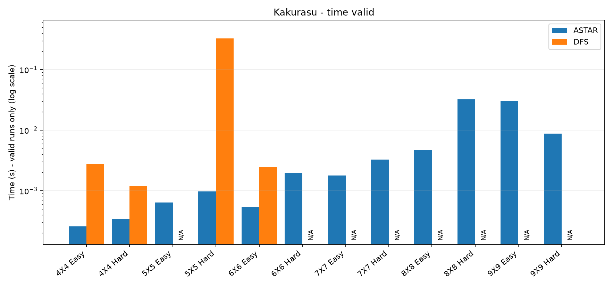
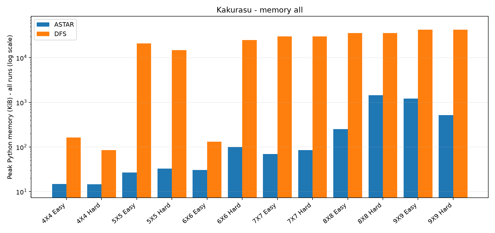
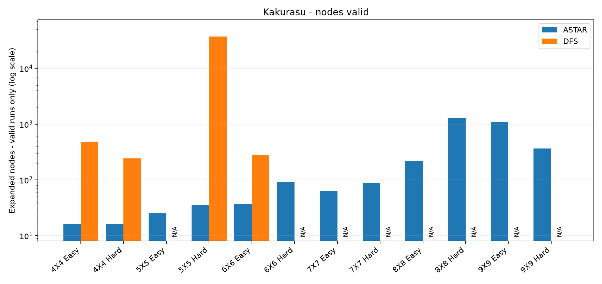
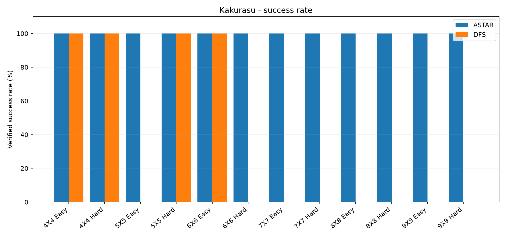
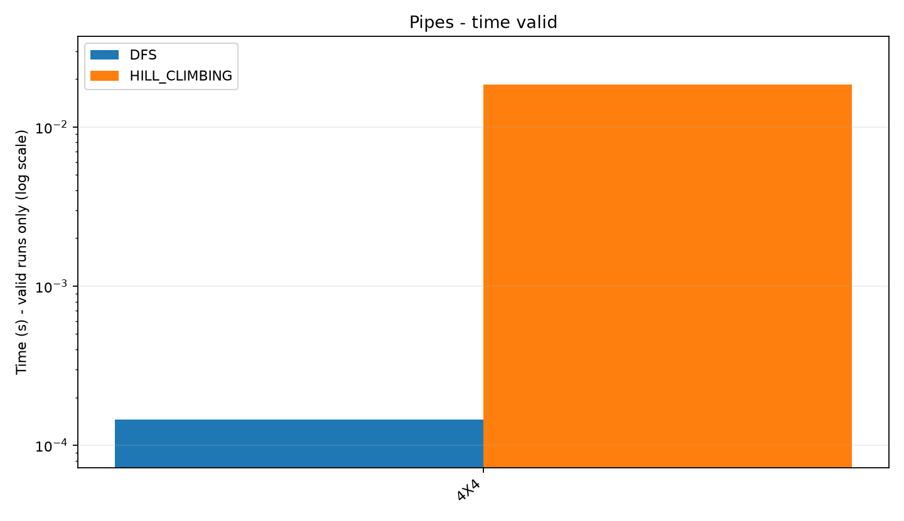
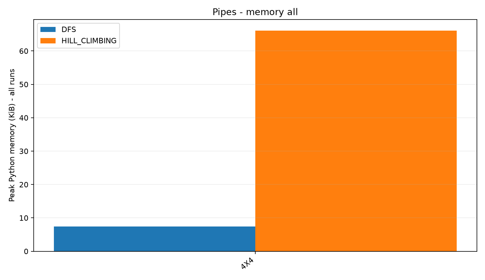
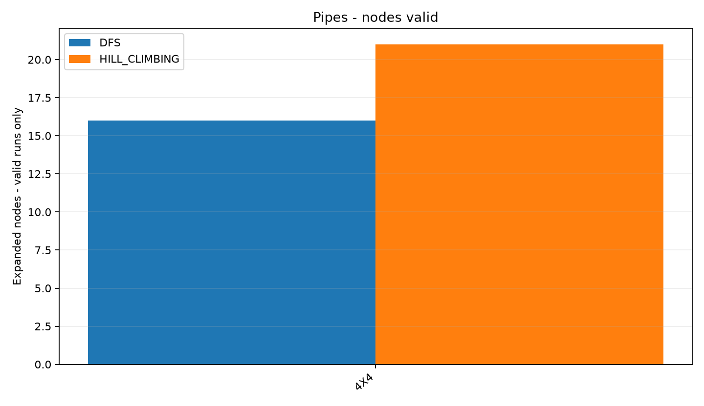
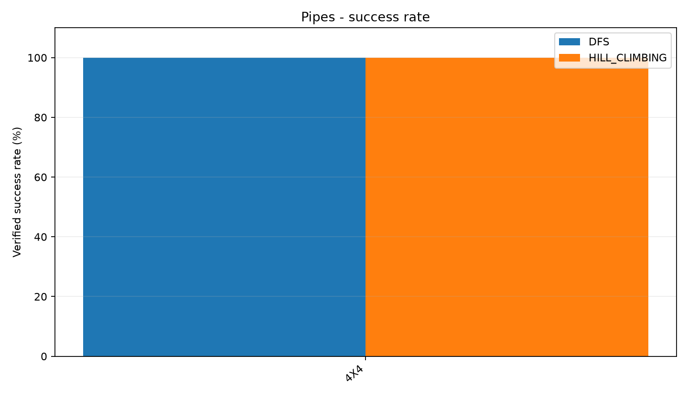

# TV5 — BÁO CÁO BENCHMARK VÀ PHÂN TÍCH THỰC NGHIỆM
## Giai đoạn 3 — Bài tập lớn Nhập môn Trí tuệ nhân tạo

**Hai bài toán:** Pipes và Kakurasu  
**Vai trò:** TV5 — Dữ liệu, Kiểm thử và Benchmark

---

## 1. Mục tiêu và phạm vi

Giai đoạn 3 của TV5 tập trung đánh giá hiệu năng của các thuật toán tìm kiếm trên hai bài toán logic Pipes và Kakurasu.

Các công việc bao gồm:

- Chạy benchmark trên các bộ input đã chuẩn bị.
- Đo thời gian thực thi, bộ nhớ và số node mở rộng.
- Kiểm tra tính chính xác của lời giải bằng `verify.py`.
- Tổng hợp dữ liệu thực nghiệm thành CSV.
- Trực quan hóa kết quả bằng các biểu đồ.
- Phân tích sự khác biệt về hiệu năng giữa các thuật toán.
- Bàn giao số liệu cho TV1 và biểu đồ cho TV4.

### 1.1. Thuật toán được đánh giá

| Bài toán | Blind Search | Heuristic Search |
|---|---|---|
| Kakurasu | DFS | A* |
| Pipes | DFS | Hill Climbing |

Một lượt thực nghiệm chỉ được xem là thành công khi thỏa mãn đồng thời:

1. Solver trả về `status=solved`.
2. Hàm `verify_solution()` xác nhận `verified=True`.

Các trạng thái `node_limit`, `time_limit` và `stuck` được ghi nhận riêng, không được xem là lời giải hợp lệ hoặc bằng chứng bài toán vô nghiệm.

---

## 2. Môi trường và cấu hình thực nghiệm

### 2.1. Môi trường

| Thành phần | Thông tin |
|---|---|
| Hệ điều hành | Windows 11 |
| Bản dựng | Windows-11-10.0.26200-SP0 |
| Ngôn ngữ | Python 3.13.0, 64-bit |
| Công cụ | VS Code |
| Đo thời gian | `time.perf_counter()` |
| Đo bộ nhớ | `tracemalloc` |
| Đo node | `SearchResult.nodes_expanded` |
| CPU/RAM | Cần bổ sung thông tin máy thực nghiệm |

### 2.2. Cấu hình benchmark

| Tham số | Giá trị |
|---|---|
| `max_nodes` | 50000 |
| `time_limit` | 5 giây |
| `repeats` | 3 |
| Kakurasu `prune` | basic |
| Hill Climbing seed chính | 0 |
| Seed bổ sung | 0, 1, 2, 3, 4 |
| `track_memory` | True |
| GUI trace | Tắt |

Hai thuật toán của mỗi puzzle được sử dụng cùng giới hạn thời gian và số node.

### 2.3. Phương pháp đo

`core.metrics.measure()` thực hiện hai lượt chạy riêng:

- Lượt thứ nhất đo thời gian thực thi bằng `time.perf_counter()`.
- Lượt thứ hai dùng `tracemalloc` để đo bộ nhớ đỉnh.

Thời gian đo không bao gồm đọc JSON, tạo đối tượng puzzle hay hiển thị giao diện GUI.

Bộ nhớ đo được là mức cấp phát Python theo `tracemalloc`, không phải tổng RAM của tiến trình.

Các chỉ số tổng hợp:

- `median_time_valid_s`: Trung vị thời gian các lượt giải đúng.
- `median_time_all_s`: Trung vị thời gian tất cả lượt chạy.
- `median_peak_kb_all`: Trung vị bộ nhớ của tất cả lượt.
- `median_expanded_valid`: Trung vị node các lượt giải đúng.
- `median_expanded_all`: Trung vị node của mọi lượt.
- `success_rate`: Tỷ lệ lượt giải đúng.

Đối với trường hợp không có lượt giải đúng, thời gian và số node của lượt giải thành công được ghi `N/A`, không thay bằng 0.

### 2.4. Khả năng tái lập

Metadata lưu thông tin cấu hình và mã băm SHA-256 của dữ liệu và mã nguồn tại thời điểm thực nghiệm.

Bộ Kakurasu được tạo trước một số thay đổi sau đó của `benchmark.py` và `puzzles/pipes.py`. Checksum hai file này không khớp source mới nhất, trong khi các file Kakurasu, core và verifier liên quan vẫn khớp.

Nếu yêu cầu tái lập chính xác toàn bộ phiên bản mã nguồn, cần dùng đúng phiên bản được ghi nhận trong metadata hoặc chạy lại benchmark trên bản source cuối cùng.

---

## 3. Bộ dữ liệu

### 3.1. Kakurasu

Bộ dữ liệu gồm 12 input:

| Kích thước | Easy | Hard |
|---|---|---|
| 4×4 | Có | Có |
| 5×5 | Có | Có |
| 6×6 | Có | Có |
| 7×7 | Có | Có |
| 8×8 | Có | Có |
| 9×9 | Có | Có |

Các file JSON chứa kích thước, gợi ý hàng/cột, nguồn và mã puzzle.

Lời giải Kakurasu được xác thực bằng tổng trọng số hàng và cột.

### 3.2. Pipes

Input hiện tại là `input_pipes_4x4.json`, gồm 16 ô.

| Loại ống | Số lượng | Đầu nối/ô |
|---|---:|---:|
| Dead-end | 2 | 1 |
| I-shape | 8 | 2 |
| L-shape | 6 | 2 |
| T-shape | 0 | 3 |

Tổng đầu nối:

`2 × 1 + 14 × 2 = 30`

Nếu các đầu nối ghép đúng, số cạnh là:

`E = 30 / 2 = 15`

Một mạng liên thông không chu trình với 16 đỉnh cần:

`E = V - 1 = 15`

Như vậy, dữ liệu thỏa điều kiện cần về số cạnh. Các lượt DFS và Hill Climbing được `verify.py` xác nhận hợp lệ.

Tuy nhiên, bộ dữ liệu mới có một input Pipes 4×4. Vì vậy chưa đủ cơ sở để phân tích hiệu năng theo kích thước hoặc độ khó.

---

## 4. Kết quả thực nghiệm Kakurasu

### 4.1. Tổng quan

Tổng lượt chạy:

`12 input × 2 thuật toán × 3 lượt = 72 lượt`

| Chỉ tiêu | DFS | A* |
|---|---:|---:|
| Tổng lượt | 36 | 36 |
| Giải hợp lệ | 12 | 36 |
| Chạm node limit | 24 | 0 |
| Input giải được | 4/12 | 12/12 |
| Tỷ lệ thành công | 33,33% | 100% |

Tổng cộng có 48 lượt giải hợp lệ và 24 lượt dừng vì giới hạn node.

Không phát hiện lời giải `solved` sai trong bộ kết quả này.

### 4.2. Bảng số liệu chi tiết

`t_all` và `t_valid` tính bằng giây.  
`peak_all` tính bằng KiB.  
Các giá trị là trung vị của ba lượt.

| Input | Thuật toán | Hợp lệ | t_all | t_valid | Peak KiB | Nodes all | Nodes valid |
|---|---|---:|---:|---:|---:|---:|---:|
| 4×4 Easy | DFS | 3/3 | 0.002768 | 0.002768 | 164.0 | 483 | 483 |
| 4×4 Easy | A* | 3/3 | 0.000259 | 0.000259 | 14.9 | 16 | 16 |
| 4×4 Hard | DFS | 3/3 | 0.001198 | 0.001198 | 84.9 | 243 | 243 |
| 4×4 Hard | A* | 3/3 | 0.000343 | 0.000343 | 14.6 | 16 | 16 |
| 5×5 Easy | DFS | 0/3 | 0.377497 | N/A | 20988.7 | 50000 | N/A |
| 5×5 Easy | A* | 3/3 | 0.000635 | 0.000635 | 26.7 | 25 | 25 |
| 5×5 Hard | DFS | 3/3 | 0.328204 | 0.328204 | 14896.8 | 37182 | 37182 |
| 5×5 Hard | A* | 3/3 | 0.000972 | 0.000972 | 33.0 | 36 | 36 |
| 6×6 Easy | DFS | 3/3 | 0.002464 | 0.002464 | 131.9 | 276 | 276 |
| 6×6 Easy | A* | 3/3 | 0.000537 | 0.000537 | 30.6 | 37 | 37 |
| 6×6 Hard | DFS | 0/3 | 0.574238 | N/A | 24991.9 | 50000 | N/A |
| 6×6 Hard | A* | 3/3 | 0.001956 | 0.001956 | 100.1 | 91 | 91 |
| 7×7 Easy | DFS | 0/3 | 0.746630 | N/A | 30063.9 | 50000 | N/A |
| 7×7 Easy | A* | 3/3 | 0.001773 | 0.001773 | 70.0 | 64 | 64 |
| 7×7 Hard | DFS | 0/3 | 0.606779 | N/A | 30030.4 | 50000 | N/A |
| 7×7 Hard | A* | 3/3 | 0.003267 | 0.003267 | 86.0 | 88 | 88 |
| 8×8 Easy | DFS | 0/3 | 0.890542 | N/A | 35897.9 | 50000 | N/A |
| 8×8 Easy | A* | 3/3 | 0.004741 | 0.004741 | 252.6 | 221 | 221 |
| 8×8 Hard | DFS | 0/3 | 0.922250 | N/A | 35826.0 | 50000 | N/A |
| 8×8 Hard | A* | 3/3 | 0.032105 | 0.032105 | 1442.0 | 1305 | 1305 |
| 9×9 Easy | DFS | 0/3 | 1.092546 | N/A | 42465.4 | 50000 | N/A |
| 9×9 Easy | A* | 3/3 | 0.030778 | 0.030778 | 1221.0 | 1082 | 1082 |
| 9×9 Hard | DFS | 0/3 | 1.061250 | N/A | 42609.6 | 50000 | N/A |
| 9×9 Hard | A* | 3/3 | 0.008783 | 0.008783 | 518.8 | 368 | 368 |

Các dòng `0/3` của DFS đều có trạng thái `node_limit`, không phải lời giải sai.

### 4.3. Biểu đồ thời gian

**Hình K1.** So sánh thời gian trung vị trên những lượt giải hợp lệ.

Những trường hợp DFS không giải được được đánh dấu `N/A`. Trục log được sử dụng khi độ chênh giá trị lớn.

### 4.4. Biểu đồ bộ nhớ

**Hình K2.** So sánh bộ nhớ đỉnh theo `tracemalloc`.

Biểu đồ bao gồm cả những lượt DFS dừng vì giới hạn node. Do đó, không nên hiểu đây là bộ nhớ chỉ của các lời giải hoàn thành.

### 4.5. Biểu đồ số node mở rộng

**Hình K3.** So sánh số node mở rộng đối với các lượt giải hợp lệ.

### 4.6. Biểu đồ tỷ lệ thành công

**Hình K4.** Tỷ lệ giải hợp lệ của DFS và A* trên từng input.

### 4.7. Phân tích kết quả Kakurasu

**Về khả năng giải bài toán**

Trong giới hạn 50.000 node và 5 giây, A* giải thành công toàn bộ 12 input Kakurasu. DFS giải được 4 input và dừng vì giới hạn node ở 8 input còn lại.

Kết quả cho thấy A* có khả năng giải tốt hơn DFS trên bộ dữ liệu đang kiểm tra.

**Về số node mở rộng**

Ở Kakurasu 4×4 Easy:

- DFS: 483 node.
- A*: 16 node.

Ở Kakurasu 5×5 Hard:

- DFS: 37.182 node.
- A*: 36 node.

Sự khác biệt lớn về số node có liên quan đến heuristic và cơ chế ưu tiên trạng thái của A*.

**Về thời gian thực thi**

Ở 4×4 Easy:

- DFS: 0,002768 giây.
- A*: 0,000259 giây.

Ở 5×5 Hard:

- DFS: 0,328204 giây.
- A*: 0,000972 giây.

A* có thời gian thấp hơn trong các trường hợp này.

Tuy nhiên, các phép đo dưới một mili-giây dễ chịu ảnh hưởng của nhiễu hệ thống và overhead Python. Không nên suy diễn tỷ số tốc độ thành kết luận tổng quát.

**Về bộ nhớ**

Ở Kakurasu 5×5 Easy:

- DFS chạm giới hạn node với bộ nhớ trung vị 20.988,7 KiB.
- A* giải đúng với bộ nhớ trung vị 26,7 KiB.

Hai giá trị thuộc các kết cục khác nhau, vì vậy chỉ nên dùng chúng để minh họa xu hướng tiêu thụ bộ nhớ trong cấu hình hiện tại.

**Về mức độ khó**

DFS giải được 5×5 Hard nhưng không giải được 5×5 Easy trong giới hạn.

Điều này cho thấy nhãn Easy/Hard không hoàn toàn phản ánh độ khó của thuật toán tìm kiếm. Kết quả còn phụ thuộc vào cách bố trí gợi ý, thứ tự duyệt và khả năng cắt tỉa.

---

## 5. Kết quả thực nghiệm Pipes

### 5.1. Benchmark chính

Dữ liệu: `input_pipes_4x4.json`.

Mỗi thuật toán được chạy 3 lần. Hill Climbing dùng seed 0.

| Thuật toán | Lượt hợp lệ | Success | Time median (s) | Peak (KiB) | Nodes |
|---|---:|---:|---:|---:|---:|
| DFS | 3/3 | 100% | 0.000145 | 7.4 | 16 |
| Hill Climbing | 3/3 | 100% | 0.018552 | 66.1 | 21 |

Không phát hiện lời giải sai hoặc exception.

### 5.2. Biểu đồ thời gian

**Hình P1.** So sánh thời gian trung vị của DFS và Hill Climbing.

DFS có thời gian thấp hơn trên input Pipes 4×4 hiện tại.

### 5.3. Biểu đồ bộ nhớ

**Hình P2.** Bộ nhớ đỉnh của hai thuật toán theo `tracemalloc`.

### 5.4. Biểu đồ số node

**Hình P3.** DFS mở rộng 16 node; Hill Climbing mở rộng 21 node.

### 5.5. Biểu đồ tỷ lệ thành công

**Hình P4.** Cả hai thuật toán đều giải đúng cả ba lượt thử với input hiện tại.

### 5.6. Kiểm tra Hill Climbing với nhiều seed

Để đánh giá ảnh hưởng của khởi tạo ngẫu nhiên, Hill Climbing được chạy bổ sung với năm seed từ 0 đến 4.

| Seed | Status | Verified | Time (s) | Peak (KiB) | Expanded nodes |
|---:|---|---|---:|---:|---:|
| 0 | solved | True | 0.024102 | 66.2 | 21 |
| 1 | solved | True | 0.007146 | 27.3 | 7 |
| 2 | solved | True | 0.018251 | 63.7 | 20 |
| 3 | solved | True | 0.019713 | 63.8 | 20 |
| 4 | solved | True | 0.013654 | 52.7 | 16 |

Kết quả:

- Số seed giải đúng: 5/5.
- Tỷ lệ thành công trên mẫu: 100%.
- Trung vị thời gian: 0,018251 giây.
- Trung vị bộ nhớ: 63,7 KiB.
- Trung vị node: 20.
- Node mở rộng dao động từ 7 đến 21.

Kết quả cho thấy seed ảnh hưởng đến quá trình tìm kiếm và số node mở rộng của Hill Climbing.

Tuy nhiên, đây chỉ là kết quả của năm seed trên một input. Chưa đủ dữ liệu để khẳng định thuật toán luôn hội tụ.

### 5.7. Phân tích Pipes

**Về tính đúng đắn**

Cả DFS và Hill Climbing đều tìm được lời giải được `verify.py` xác nhận trên input 4×4.

Lỗi vòng kín từng phát hiện trong Giai đoạn 2 không còn tái hiện trên input đã sửa.

**Về thời gian**

DFS có thời gian trung vị 0,000145 giây, trong khi Hill Climbing là 0,018552 giây.

DFS nhanh hơn trên input này.

**Về số node**

DFS mở rộng 16 node, Hill Climbing mở rộng 21 node.

DFS gần như không phải quay lui trên đề thử nghiệm, nên chưa thể đánh giá hiệu năng tìm kiếm của thuật toán trong các trường hợp khó hơn.

**Về bộ nhớ**

DFS dùng 7,4 KiB và Hill Climbing dùng 66,1 KiB theo phép đo hiện tại.

Sự khác biệt có liên quan đến cấu trúc trạng thái, thao tác tìm kiếm và số lượng trạng thái được tạo/xử lý.

**Giới hạn**

Bộ dữ liệu chỉ có một input 4×4. Do đó, kết quả không đủ để khẳng định DFS luôn hiệu quả hơn Hill Climbing trên Pipes.

Cần bổ sung input đa dạng để đánh giá đầy đủ hơn.

---

## 6. Đánh giá chung và giới hạn thực nghiệm

### 6.1. Tính đúng đắn

Trong các lượt benchmark chính:

- Không có lời giải `solved` bị verifier từ chối.
- Các lượt DFS Kakurasu không thành công đều do chạm giới hạn node.
- Pipes đã tìm được lời giải hợp lệ bằng cả DFS và Hill Climbing.

### 6.2. Giới hạn cấu hình

Giới hạn 50.000 node và 5 giây được áp dụng thống nhất cho các thuật toán.

Tuy nhiên, đây là các giới hạn phục vụ đánh giá thực nghiệm, không phải giới hạn lý thuyết của thuật toán.

Các phép đo thời gian rất ngắn có thể dao động theo tình trạng máy.

### 6.3. Giới hạn dữ liệu

Kakurasu có 12 input, trong khi Pipes hiện chỉ có một input.

Do đó, mức độ đầy đủ của hai bộ thực nghiệm không tương đương nhau.

Không so sánh trực tiếp số node hoặc thời gian giữa Kakurasu và Pipes như thể chúng là cùng một bài toán.

### 6.4. Giới hạn phép đo bộ nhớ

`median_peak_kb_all` bao gồm mọi lượt chạy, kể cả lượt thất bại.

Trong khi đó, `median_time_valid_s` và `median_expanded_valid` chỉ tính các lượt giải thành công.

Các biểu đồ cần nêu rõ điều này để tránh diễn giải sai.

---

## 7. Kết luận

### 7.1. Kakurasu

A* giải được toàn bộ 12 input trong giới hạn thực nghiệm, trong khi DFS chỉ giải được 4 input.

A* nhìn chung mở rộng ít node hơn và có hiệu quả tốt hơn trên bộ dữ liệu đang sử dụng.

### 7.2. Pipes

DFS và Hill Climbing đều giải đúng input 4×4.

DFS có thời gian, bộ nhớ và số node mở rộng thấp hơn trong cấu hình thử nghiệm hiện tại.

Tuy nhiên, chưa đủ cơ sở để kết luận thuật toán nào hiệu quả hơn trên mọi bài toán Pipes.

### 7.3. Công việc hoàn thành của TV5

TV5 đã:

- Kiểm tra tính hợp lệ của bộ dữ liệu.
- Xác thực lời giải độc lập với solver.
- Chạy benchmark cho hai bài toán.
- Thu thập dữ liệu thời gian, bộ nhớ và node.
- Đánh giá Hill Climbing bằng nhiều seed.
- Xuất CSV và metadata.
- Tạo các biểu đồ so sánh.
- Tổng hợp kết quả thực nghiệm phục vụ báo cáo và slides.

### 7.4. Công việc còn cần phối hợp

- TV1: Xác nhận cấu hình benchmark chính thức và tích hợp kết quả vào báo cáo chung.
- TV2: Bổ sung thêm input Pipes hợp lệ nếu cần đánh giá độ khó/kích thước.
- TV3: Đối chiếu kết quả Kakurasu với phần phân tích của thành viên.
- TV4: Sử dụng ảnh biểu đồ và bảng số liệu để hoàn thiện slides.

---

## 8. Các file kết quả và khả năng tái lập

### Mã nguồn

- `verify.py`
- `benchmark.py`
- `tools/tv5_make_charts.py`

### Dữ liệu Kakurasu

- `docs/experiments/tv5-gd3/kakurasu/benchmark_raw.csv`
- `docs/experiments/tv5-gd3/kakurasu/benchmark_summary.csv`
- `docs/experiments/tv5-gd3/kakurasu/metadata.json`

### Dữ liệu Pipes

- `docs/experiments/tv5-gd3/pipes/benchmark_raw.csv`
- `docs/experiments/tv5-gd3/pipes/benchmark_summary.csv`
- `docs/experiments/tv5-gd3/pipes/metadata.json`

### Khảo sát nhiều seed

- `docs/experiments/tv5-gd3/seeds/`

### Biểu đồ

- `docs/experiments/tv5-gd3/charts/`

Toàn bộ dữ liệu được giữ để phục vụ kiểm tra, tái lập và giải thích kết quả thực nghiệm.

**Lưu ý trước khi nộp:** Bổ sung CPU/RAM, mã commit source cuối và chạy lại benchmark nếu nhóm có sửa đổi thuật toán, heuristic hoặc dữ liệu.